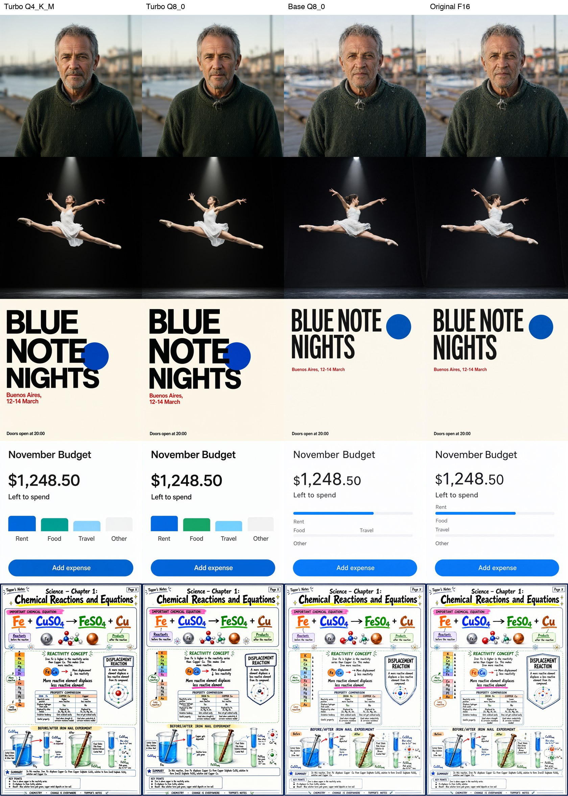
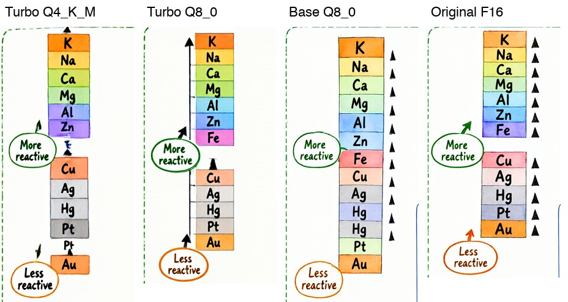
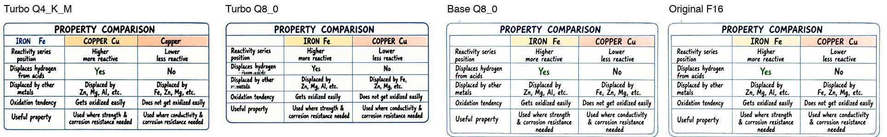

# Qwen-Image-2.1 on an M1 Pro with 32 GB

How fast does Qwen-Image-2.1 run on a 2021 MacBook Pro, how much memory does it take, and what do you lose with the smaller versions? This repo runs four versions of the model on the same five prompts with [stable-diffusion.cpp](https://github.com/leejet/stable-diffusion.cpp) and Metal, and keeps every image, log and number.



## Short answer

- **Turbo Q8_0 is the best choice on this Mac.** About 5 minutes per 1024×1024 image, 23 GB peak memory, no swap growth, good text.
- **Turbo Q4_K_M is not faster.** It saves 7 GB of memory, but each step is slightly slower (33 s against 31 s), and small text on the dense poster breaks.
- **Base (non-distilled) takes about 4.3 times longer**: 40 steps instead of 8, about 22 minutes per image. It renders dense small text best. On two simple layout prompts it follows the prompt less well than Turbo.
- **The original F16 model runs, but only with heavy swap.** Peak memory is 44 GB on a 32 GB machine and swap grows to 21 GB. Its images are almost the same as Base Q8_0, so the extra memory gives little.
- **Do not use CFG 6 with Base.** The stable-diffusion.cpp docs example uses `--cfg-scale 6.0`. With it, text-heavy images come out washed out and half empty. The official pipeline samples with no guidance (CFG 1). See [CFG 6 versus CFG 1](#cfg-6-versus-cfg-1).

## Models

| Name here | Diffusion weights | Size | Text encoder | Steps | CFG |
| --- | --- | --- | --- | --- | --- |
| Turbo Q4_K_M | [abenzerps/Qwen-Image-2.1-Turbo-Quantized](https://huggingface.co/abenzerps/Qwen-Image-2.1-Turbo-Quantized) `qwen-image-2.1-turbo-Q4_K_M.gguf` | 4.1 GB | Qwen3-VL 8B INT8 (9.4 GB) | 8 | 1 |
| Turbo Q8_0 | same repo, `qwen-image-2.1-turbo-Q8_0.gguf` | 7.6 GB | Qwen3-VL 8B INT8 (9.4 GB) | 8 | 1 |
| Base Q8_0 | [unsloth/Qwen-Image-2.1-GGUF](https://huggingface.co/unsloth/Qwen-Image-2.1-GGUF) `qwen-image-2.1-Q8_0.gguf` | 7.6 GB | Qwen3-VL 8B INT8 (9.4 GB) | 40 | 1 |
| Original F16 | same repo, `qwen-image-2.1-F16.gguf` | 14.2 GB | Qwen3-VL 8B BF16 (17.5 GB) | 40 | 1 |

All versions use the same VAE (`qwen_image_2.1_vae_bf16.safetensors`, 0.7 GB), the Euler sampler and seed 42. Turbo uses the `--sigmas qwen-image-2.1-turbo` schedule. Base uses the official defaults from `QwenImage21Pipeline` in diffusers: 40 steps and `true_cfg_scale=1.0`.

"Original F16" is the non-quantized Base model in GGUF form with the full BF16 text encoder. It is as close to the official weights as stable-diffusion.cpp allows.

## Hardware

- MacBook Pro, Apple M1 Pro: 10 CPU cores, 16 GPU cores, 32 GB unified memory
- macOS 15.8, on mains power, sleep blocked with `caffeinate`
- Metal reports `recommendedMaxWorkingSetSize = 22906.50 MB`, so the GPU can use about 22.9 GB
- stable-diffusion.cpp at commit `5a1ba5d`, built with `-DSD_METAL=ON`

## Results

Time is the `generate_image` time that sd-cli reports: text encoding, sampling and VAE decoding, without loading the weights. Peak memory is the `peak memory footprint` from `/usr/bin/time -l`. Swap is the highest `vm.swapusage` during the run; 2 to 4 GB of swap was already in use before each run. Thermal is the macOS thermal pressure level, where 0 means nominal.

| Model | Size | Finished | Mean time | Range | Per step | Peak memory | Peak swap | Thermal |
| --- | --- | --- | --- | --- | --- | --- | --- | --- |
| Turbo Q4_K_M | 1024x1024 | 8/8 | 5:10 | 5:08-5:12 | 33 s | 16.2 GB | 2.0 GB | 0 |
| Turbo Q4_K_M | 1024x1536 | 2/2 | 10:58 | 10:56-10:59 | 54 s | 17.8 GB | 2.6 GB | 0 |
| Turbo Q8_0 | 1024x1024 | 8/8 | 5:01 | 4:58-5:03 | 31 s | 23.3 GB | 2.0 GB | 0 |
| Turbo Q8_0 | 1024x1536 | 2/2 | 10:38 | 10:37-10:39 | 51 s | 24.9 GB | 5.4 GB | 0 |
| Base Q8_0 | 1024x1024 | 4/4 | 21:37 | 21:35-21:39 | 31 s | 23.4 GB | 2.0 GB | 0 |
| Base Q8_0 | 1024x1536 | 1/1 | 37:49 | 37:49 | 51 s | 24.9 GB | 6.5 GB | 0 |
| Original F16 | 1024x1024 | 4/4 | 23:18 | 23:01-23:31 | 30 s | 44.1 GB | 21.2 GB | 0 |
| Original F16 | 1024x1536 | 1/1 | 59:16 | 59:16 | 49 s | 45.7 GB | 22.6 GB | 0 |

Turbo ran every prompt twice (`run-1`, `run-2`). Base and Original ran once, because one pass takes 2 to 3 hours.

Time per stage (mean):

| Model | Size | Text encoder | Sampling | VAE decode |
| --- | --- | --- | --- | --- |
| Turbo Q4_K_M | 1024x1024 | 14 s | 270 s | 26 s |
| Turbo Q4_K_M | 1024x1536 | 163 s | 454 s | 41 s |
| Turbo Q8_0 | 1024x1024 | 15 s | 260 s | 27 s |
| Turbo Q8_0 | 1024x1536 | 163 s | 436 s | 40 s |
| Base Q8_0 | 1024x1024 | 14 s | 1256 s | 27 s |
| Base Q8_0 | 1024x1536 | 163 s | 2068 s | 39 s |
| Original F16 | 1024x1024 | 94 s | 1278 s | 26 s |
| Original F16 | 1024x1536 | 1450 s | 2067 s | 39 s |

What the numbers show:

- **Sampling speed does not depend on the weight format here.** Q4_K_M, Q8_0 and F16 all take 30 to 33 s per step at 1024×1024. On this GPU the step is limited by compute, not by reading the weights. Q4_K_M is a little slower, probably because unpacking K-quants costs extra work.
- **The time difference between Turbo and Base comes from the step count**: 8 steps against 40.
- **The Original F16 is slow only in the text encoder.** The BF16 encoder runs on the CPU and does not fit in memory next to the F16 diffusion weights, so it reads from swap: 94 s instead of 14 s on short prompts, and 24 minutes instead of 2.7 minutes on the long poster prompt.
- **The poster prompt (7,791 characters) makes the text encoder about 11 times slower** than the short prompts, on every model.
- **The runs are stable.** All 36 runs finished, none crashed or timed out, thermal pressure stayed nominal, and run times vary by under 1% (about 2% for Original F16).
- **The runs are repeatable.** With the same seed, run 1 and run 2 of both Turbo versions are identical pixel for pixel.

Full tables, including SSIM and PSNR between pairs, are in [results/m1-pro-32gb/summary.md](results/m1-pro-32gb/summary.md). Raw numbers are in [metrics.json](results/m1-pro-32gb/metrics.json), and every image has its full sd-cli log next to it.

## Quality

I reviewed every image by eye against its prompt. This is one person's review of one seed per prompt, not a statistical study.

| Prompt | Turbo Q4_K_M | Turbo Q8_0 | Base Q8_0 | Original F16 |
| --- | --- | --- | --- | --- |
| 1. Portrait | good | good | good, most detail | same as Base Q8_0 |
| 2. Ballet jump | good | good | good | same as Base Q8_0 |
| 3. Swiss poster | text correct, circle overlaps title | text correct, circle overlaps title | text correct, circle **does not** overlap title | same as Base Q8_0 |
| 4. Finance app UI | text correct, four labeled bars | text correct, four labeled bars | text correct, progress bars instead of a bar chart | same as Base Q8_0 |
| 5. Official poster | many small-text errors | a few small-text errors | one error | no errors found |

The full checklist (text accuracy, anatomy, prompt match, artifacts) is in [summary.md](results/m1-pro-32gb/summary.md#quality-review).

The official Turbo poster prompt is the hardest test. Its reactivity series and table show where each version breaks:



Turbo Q4_K_M garbles Fe and repeats Pt. Base Q8_0 repeats Hg. Turbo Q8_0 and Original F16 are correct.



Turbo Q4_K_M shifts the column headers ("IRON Fe" lands in the label column and a third "Copper" column appears). Turbo Q8_0 garbles two small lines under the row labels. Both Base versions are clean.

How close the quantized versions are to each other (SSIM, 1.0 means identical):

| Prompt | Turbo Q4 vs Q8 | Base Q8 vs F16 |
| --- | --- | --- |
| Portrait | 0.915 | 0.996 |
| Ballet jump | 0.882 | 0.989 |
| Swiss poster | 0.899 | 0.969 |
| Finance app UI | 0.935 | 0.958 |
| Official poster | 0.598 | 0.872 |

Q8_0 keeps the Base model very close to F16. Q4_K_M changes the Turbo model much more, most of all on the dense poster.

## CFG 6 versus CFG 1

My first Base runs used the settings from the stable-diffusion.cpp docs example: 20 steps and `--cfg-scale 6.0`. The UI and poster prompts came out washed out and half empty:


The diffusers pipeline explains why: *"Qwen-Image 2.1 is meant to be sampled without guidance, hence the default of 1.0."* Its default is 40 steps. With CFG above 1, every step runs the model twice, so 20 steps at CFG 6 take as long as 40 steps at CFG 1 and give much worse images.

I kept those runs as `base-q8-cfg6` and `base-f16-cfg6`, so the mistake stays visible. The poster comparison is in [docs/crop-cfg6-poster.jpg](docs/crop-cfg6-poster.jpg).

## Metal crash in the text encoder

With the text encoder on the GPU, sd-cli crashes after about 9 seconds with `EXC_BAD_ACCESS (SIGSEGV)` inside the Metal driver (`AGXMetalG13X`, `setBuffer`), called from `LLM::LLMRunner::compute`. Every run here uses `--backend te=cpu`, which keeps the text encoder on the CPU. The diffusion model and VAE stay on Metal.

## Reproduce

Requirements: macOS on Apple Silicon, Xcode command line tools, [uv](https://github.com/astral-sh/uv), git and about 70 GB of free disk space.

```bash
./setup.sh                     # Python environment and sd-cli with Metal
.venv/bin/python download.py   # about 61 GB of weights into models/
.venv/bin/python benchmark.py --variant turbo-q8 --smoke   # 512x512, 2 steps
./run_all.sh                   # full matrix, 9 to 10 hours on an M1 Pro
.venv/bin/python report.py     # tables, grid and crops
```

`benchmark.py` skips prompts that already have a result, so you can stop `run_all.sh` and start it again. To add another Mac, change `HARDWARE` in `benchmark.py` and `RESULTS` in `report.py`.

The quality review (`quality.json`) and the crop boxes (`crops.json`) are written by hand.

## Files

```
benchmark.py        runs one model over the prompts, records time, memory, swap and thermal state
variants.py         the four models and their settings
prompts.json        the five prompts
report.py           builds summary.md, docs/grid.jpg and the crops
results/m1-pro-32gb/<model>/run-<n>/   images and full sd-cli logs
results/m1-pro-32gb/metrics.json       one record per image
```

Images from the second Turbo run are not committed, because they are identical to the first run. Their logs are.

## Limits

- One Mac, one seed per prompt. Another seed can change which model wins a prompt.
- The quality review is manual.
- All images are 1024×1024 or 1024×1536. The official default is 2048×2048, which was not tested here.
- The Mac was idle but not freshly rebooted, so 2 to 4 GB of swap was in use before each run.
- Only stable-diffusion.cpp was tested. MLX or diffusers on MPS may give different numbers.

## License

The code in this repo is under the [MIT license](LICENSE). The generated images come from Qwen-Image-2.1, which is released under the Qwen Research License: research and non-commercial use only. The model weights are not in this repo; `download.py` gets them from Hugging Face.
